<div align="center">

# NEON VEIL: ZERO PROTOCOL

**A rain-soaked cyberpunk action game about speed, steel and memory.**
Parkour across a 10 km city, cut through Syndicate patrols with blades of fire,
frost and void, grow a 4,000-node passive tree, and bring down the Gorgon. Solo or in co-op.

[](https://github.com/Kukzze/neon-veil/actions/workflows/ci.yml)
[](https://github.com/Kukzze/neon-veil/releases/latest)


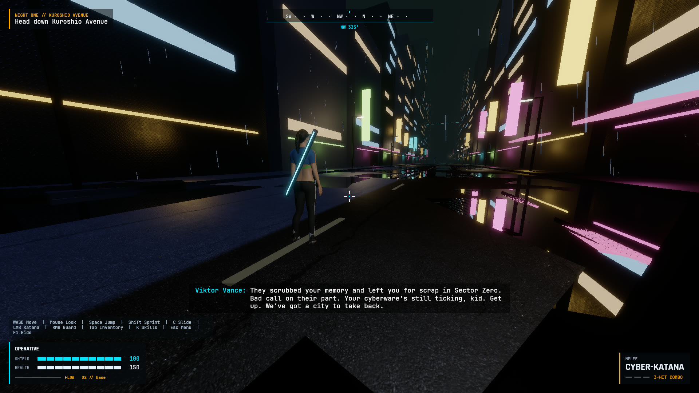

**[Download the latest build](https://github.com/Kukzze/neon-veil/releases/latest)** · [Features](#features) · [Controls](#controls) · [Build from source](#build-from-source) · [Architecture](#architecture)

</div>

---

## The story

They scrubbed your memory and left you for scrap in Sector Zero. Your cyberware
disagreed. Wake up with **AURA** in your head and **Viktor Vance** in your ear,
and take back one street of the city, one Syndicate encounter at a time, until
the Syndicate's enforcer, **the Gorgon**, steps in to finish the job.

*Night One* is fully voiced, subtitled, and built around checkpoints, so a
death costs you an encounter, never the night.

<p align="center">
  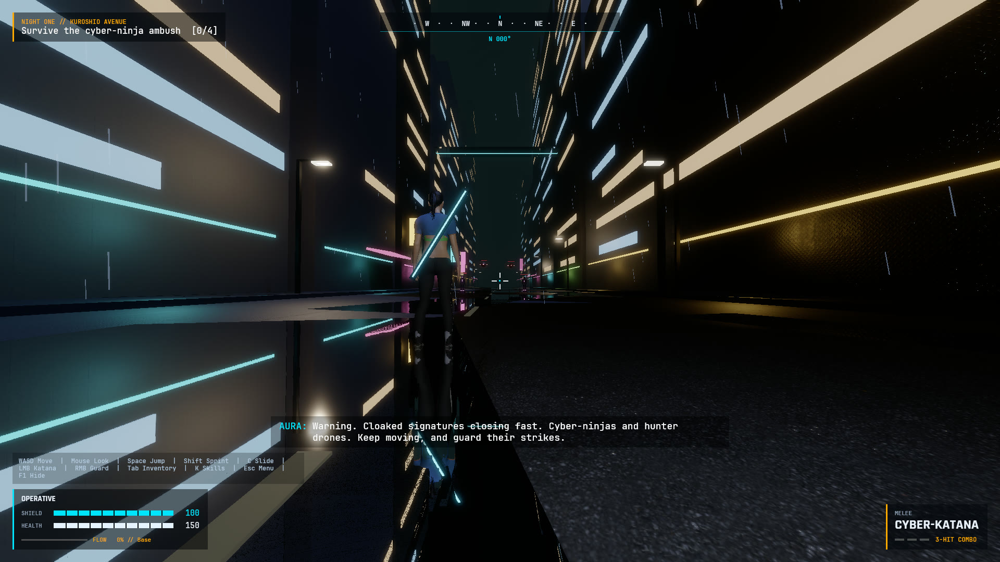
  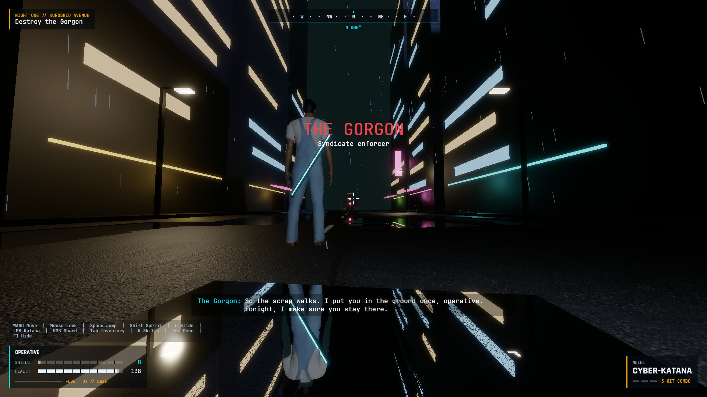
</p>

## Features

### Build an operative that is actually yours

A realistic human body driven by **86 sliders**: gender, age, muscle, weight,
height and heritage, then torso, chest, waist, hips, arms, hands, fingers, legs,
feet, head shape, jaw, chin, cheeks, eyes, brows, nose, lips and ears. Every
change reshapes the mesh live and refits the skeleton, so long legs run like
long legs.

<p align="center">
  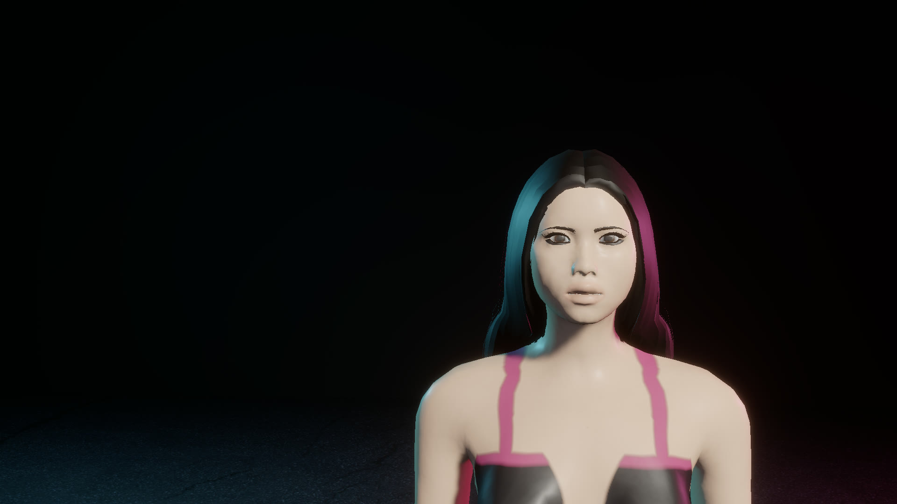
  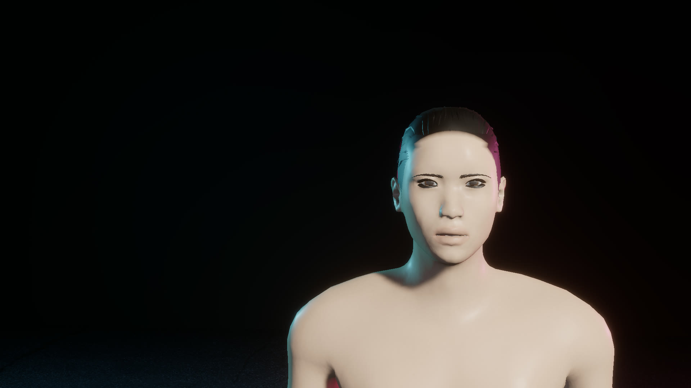
</p>

- **Ten real hair styles**, from buzz cuts and bobs to braids, ponytails and an afro; plus **twelve brow styles** and lashes. Everything takes your hair colour.
- **Clothes that fit any body**: work wear, sportswear, casual and elegant sets and shoes, refitted to every slider. Skin underneath is hidden, so nothing pokes through.
- **Smooth, detailed skin**: real skin detail, soft normal mapping and a dewy sheen, tinted to any of eight tones.
- **Makeup**: lipstick, eyeshadow and blush, each with its own colour palette and intensity.
- **Six presets** to start from, a randomizer, and a **player card** with your callsign and title.
- **Co-op ready**: your look and card travel with you, so other players see your operative.

<p align="center">
  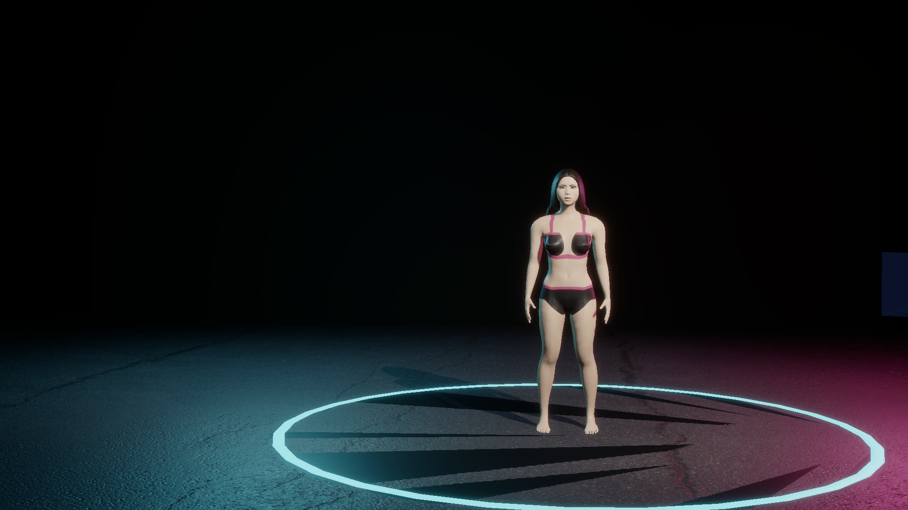
  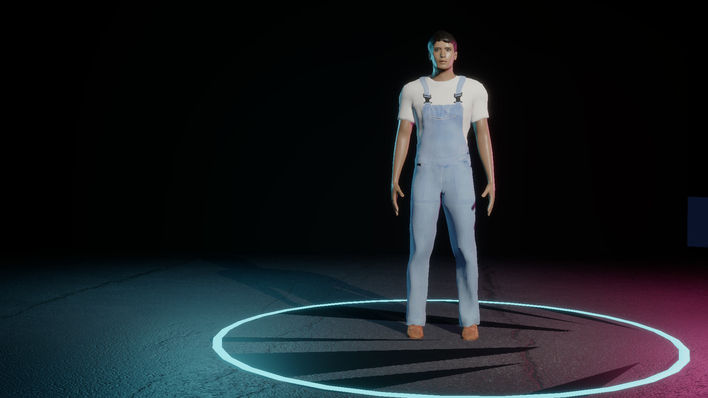
  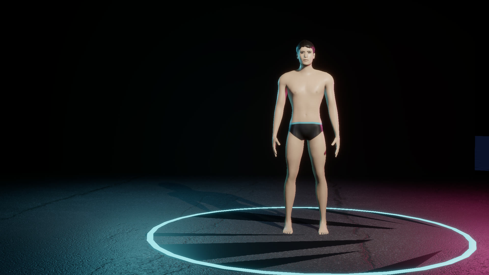
</p>

### Move like water

- **A 10 km x 10 km city** streamed around you: downtown towers, low rooftops, alleys and street clutter, ringed by a barrier you cannot leave.
- **Real parkour**: walls stop you, kerbs and ledges are stepped onto, sprint-vault crates, grab and mantle ledges, wall-run along towers and wall-jump off them, run across rooftops.
- **Responsive movement**: instant walk and sprint, jumps with coyote time and a jump buffer, and **momentum slides** that carry your speed.
- **Deterministic client prediction** against an authoritative server; the same movement code runs on both, so what you press is what happens.
- A **procedurally animated body**: stride-matched running, sprint lean, jump tuck, slides and natural secondary motion, all adapted to your build.

### Fight with a blade

- **The Arsenal**: **500 weapons** in ten classes (katanas, dual blades, batons, gauntlets, mono-whips, claymores, spears, scythes, axes, hammers) from ten makers, and **2,900 weapon mods** in ten tiers. Weapons drop from the Syndicate in four rarities with up to six mods; compare, equip and salvage them in the Armory.
- **Six elements**: physical, fire (ignite), frost (chill), shock (overload), toxin (corrode) and void (armour-piercing), with critical strikes, status chance and potency, boss and execute damage, and life, health and shields on hit and kill.
- **The Neural Lattice**: a **4,393-node passive tree** in six sectors (Blade, Ghost, Bulwark, Aegis, Reaver, Pulse) with named notables and trade-off keystones. Kills earn experience; every level is a point to spend.
- A **three-hit cyber-katana combo** with swing trails and hit detection, a **guard and parry** stance, and posture damage.
- **Enemies that think**: grunts, cloaked ninjas, hunter drones, shielded heavies, netrunners, and a multi-phase boss with hazards. Every Syndicate soldier is a real, fitted human with their own face, build, hair and gear.

### A city that breathes

<p align="center">
  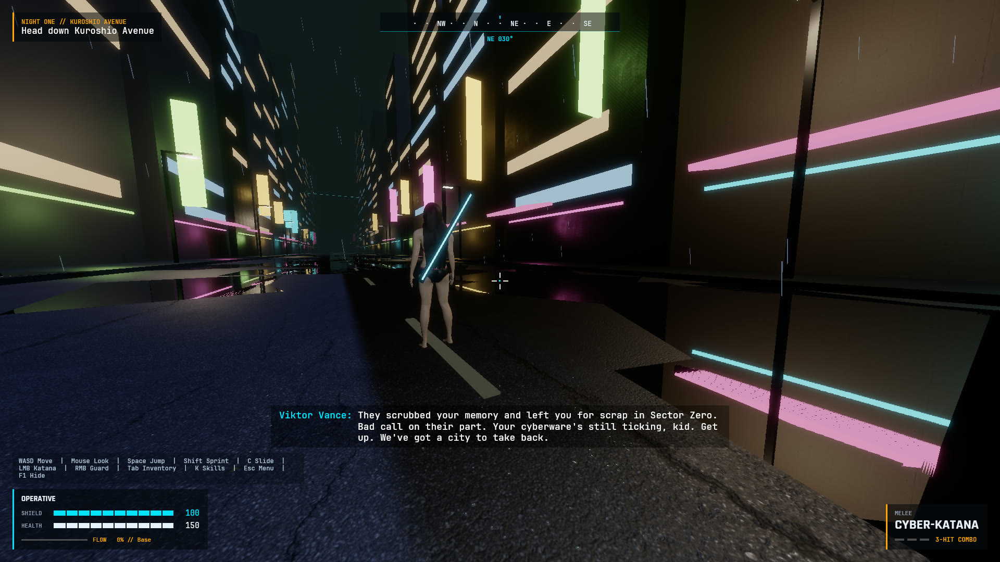
</p>

- A **procedural neon district**: towers with lit windows, floor ledges, pilasters, AC units, drainpipes, rooftop tanks and antennas, blade signs, storefront light spill, skybridges and a skyline with warning beacons.
- **Photo-scanned materials** (asphalt, worn concrete, metal plate) and **screen-space reflections** that make every puddle mirror the neon.
- HDR, bloom, filmic tonemapping, rain and district-tuned fog.
- **Synthesized sound**: footsteps, thrusters, katana swings, impacts, rain and a dark synth bed. No sample packs, every sound is generated from DSP.

### A HUD that stays out of the way

<p align="center">
  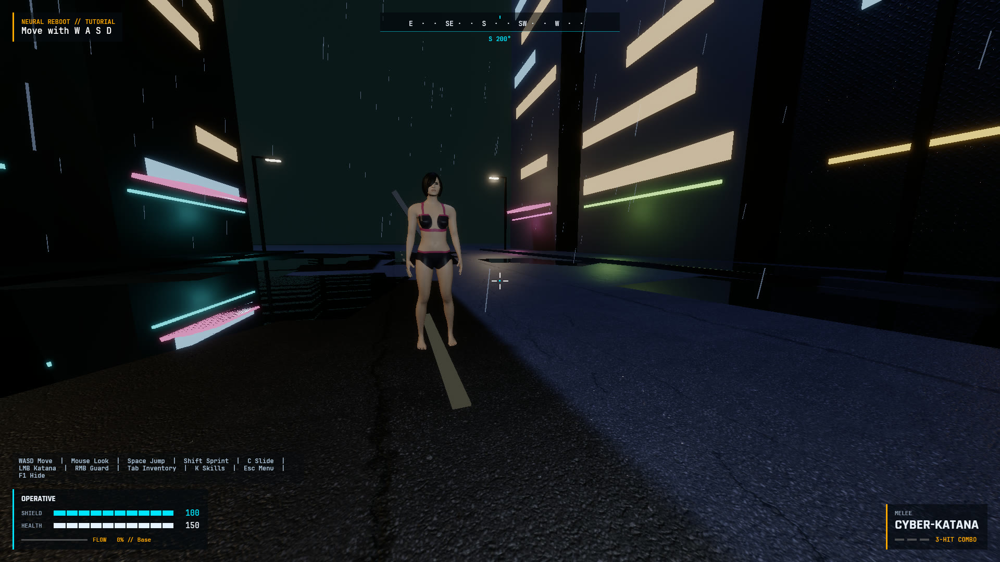
  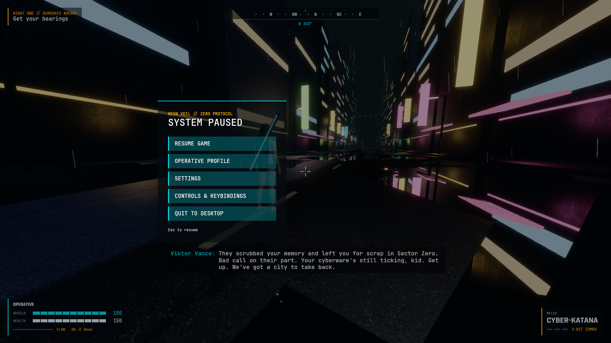
</p>

Vitals with damage trails, a scrolling compass tape, a weapon card with combo
pips, objective and subtitle panels, a pause menu with a full controls
reference, and a **first-run tutorial** that only advances when you actually do
the move.

## Controls

| Key | Action | Key | Action |
| --- | --- | --- | --- |
| `W A S D` | Move | `LMB` | Katana combo |
| Mouse | Look | `RMB` | Guard / parry |
| `Space` | Jump | `MMB` | Heavy attack |
| `Shift` | Sprint | `Alt` | Dodge roll |
| `C` / `Ctrl` | Crouch, slide while sprinting | `F` | Interact |
| `Tab` | Inventory | `K` | Skills |
| `V` | Toggle camera | `Esc` | Pause, settings, operative profile |
| `I` | Armory (weapons) | `P` | Neural Lattice (passive tree) |
| `F1` | Hide the controls badge | | |

Gamepads are supported too.

## Play

1. Download the archive for your platform from the **[latest release](https://github.com/Kukzze/neon-veil/releases/latest)**.
2. Unzip it and run `game_client` (`game_client.exe` on Windows).
3. On first launch you play the tutorial, build your operative, then Night One begins. Your operative is saved to `config/operative.json`; change it any time from **Esc → Operative profile**.

**Co-op:** one player runs `game_server` (it listens on `0.0.0.0:5000`), everyone else starts `game_client --connect <host>:5000`.

### Useful flags

| Flag | Effect |
| --- | --- |
| `--connect <addr>` | Join a server instead of playing offline |
| `--creator` | Open the operative creator |
| `--preset <name>` | Use a preset: Vanguard, Wraith, Hana, Jun, Bruiser, Runner |
| `--checkpoint <1-4>` | Start Night One at an encounter (4 is the Gorgon) |
| `--tutorial` | Replay the tutorial |
| `--showcase` | Line up one of each Syndicate enemy in front of you |
| `--greybox` | Load the parkour test gym and developer tools |
| `--capture <file.png>` | Save a screenshot and exit (with `--capture-view <yaw>,<pitch>` and `--capture-after <secs>`) |

## Build from source

You need Rust (the toolchain pins **1.82**). On Linux, also install `pkg-config clang mold libasound2-dev libudev-dev libwayland-dev libxkbcommon-dev libx11-dev`.

```bash
git clone https://github.com/Kukzze/neon-veil.git
cd neon-veil
cargo run -p game_client --release          # play offline
cargo run -p game_server --release          # host a co-op server
cargo test --workspace                       # 700+ tests
```

The companion web portal lives in `web/companion` (Next.js): `npm install && npm run dev`.

## Architecture

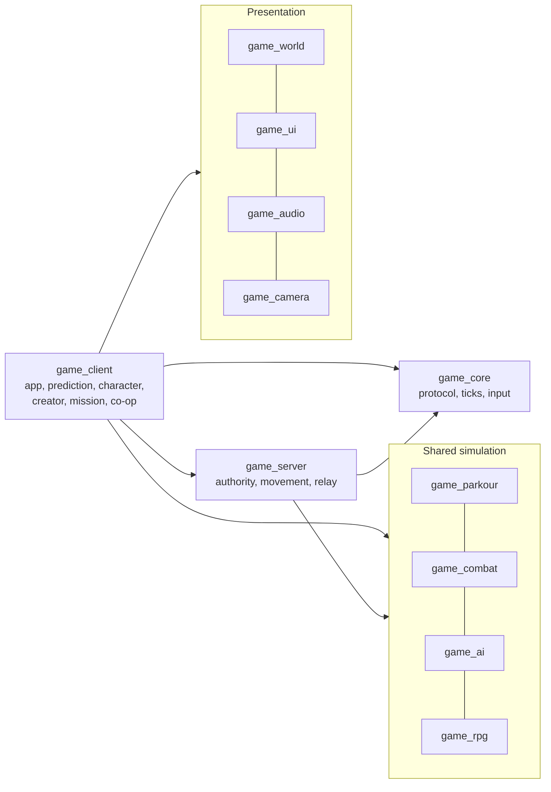

- **15 crates** in one Cargo workspace, built on **Bevy 0.15** and **Avian3D**, with a 64 Hz fixed simulation tick.
- **Networking** over renet; offline play runs the same server in-process over a loopback transport.
- **Characters** come from the MakeHuman base mesh: morph targets are applied on the CPU (no GPU morph limits), joints are refitted from vertex landmarks, and hair and clothes are bound to body vertices so they follow every slider. The asset pipeline lives in [`tools/character`](tools/character).

## Credits

Made by **Cutting Onion Studios**. Created by **Daksh Rawat** ([@kukzze](https://www.instagram.com/kukzze/) · [GitHub](https://github.com/Kukzze)).

Third-party assets, all CC0 unless noted:

- Human base mesh, morph targets, rig, hair, brows, lashes, clothes and skin detail: [MakeHuman](http://www.makehumancommunity.org) (CC0).
- Street and facade textures: [Poly Haven](https://polyhaven.com) (CC0).
- Fonts: JetBrains Mono and Rajdhani (SIL Open Font License).

© Cutting Onion Studios. All rights reserved.
